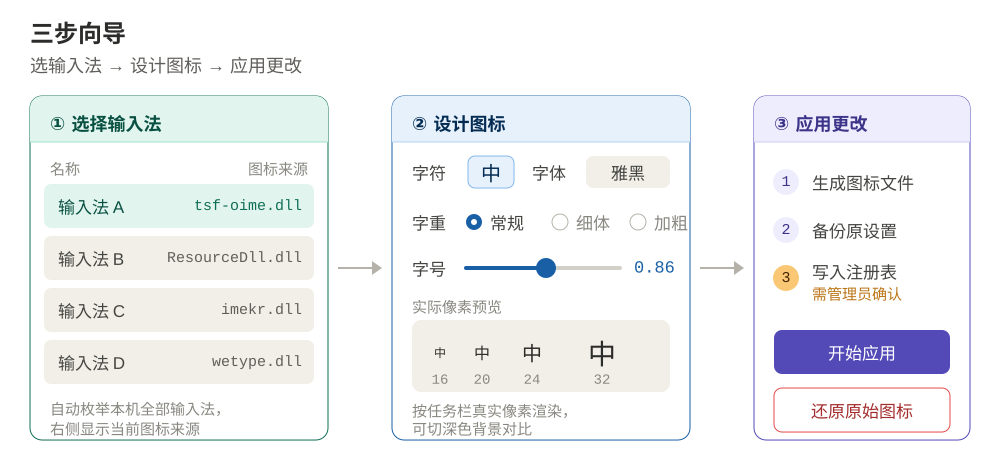

# IME 任务栏图标工具

把 Windows 任务栏「输入指示器」上某个输入法的图标，换成你自己指定的一个字符。

比如把某个中文输入法的卡通头像换成白底黑字的「中」「五」「拼」——
风格对齐微软拼音自带的那个「中」。

**只改 2 个注册表值，不动系统文件，随时一键还原。**

---

## 它长什么样

三步向导：选输入法 → 设计图标 → 应用。



预览区按**任务栏上的真实像素尺寸**渲染，还支持切深色背景看效果。

> 上图是矢量示意图，用于说明界面结构，不代表某个具体机器的实际输入法列表。

---

## 下载使用（推荐）

不想装 Python？直接下打包好的版本：

### **[⬇ 下载最新版 ImeIconTool-win64.zip](https://github.com/ddjddjxgb-cpu/ime-icon-tool/releases/latest)**

1. 下载 zip，**完整解压**（`ImeIconTool` 目录内的 `_internal` 文件夹必须和 `ImeIconTool.exe` 放在一起）
2. 双击 `ImeIconTool.exe`
3. 选输入法 → 输入字符并选样式/字体（默认白底黑字，浅深任务栏皆清晰；可选黑底白字或透明底） → 点「开始应用」→ UAC 点「是」
4. 想还原：点「还原成原始图标」，一步退回原样

包内附 `使用说明.txt`（含还原与卸载说明）。程序免安装，只写
`%LOCALAPPDATA%\ImeIconTool\` 一个目录；卸载时请**先在工具里点「还原成原始图标」**，再删掉程序文件夹和该数据目录即可。

> 需要 **Windows 10/11 64 位**。程序未做代码签名，首次运行可能提示
> 「Windows 已保护你的电脑」，点「更多信息 → 仍要运行」。
> 校验文件完整性的方法见下文「使用须知」第 3 条。

---

## 从源码运行

### 方式一：直接运行源码（无需构建）

需要 **Windows 10/11 64 位** + **Python 3.9+**（含 tkinter 与 Pillow）。

```bat
pip install -r requirements.txt
python src\ime_icon_tool.pyw
```

或者双击 `src\ime_icon_tool.pyw`（`.pyw` 会以无控制台窗口方式启动）。

### 方式二：自己打包成发布包（推荐用统一脚本）

```bat
pip install -r requirements.txt
pip install pyinstaller
python scripts\build_release.py
```

脚本会先跑完整测试与语法检查，再用 `--onedir` 构建到 `dist\ImeIconTool\`，并自动生成 `使用说明.txt`、`dist\release\ImeIconTool-win64.zip` 与 `dist\release\SHA256SUMS.txt`。

**为什么用 `--onedir` 而不是 `--onefile`**：

`--onefile` 会在每次启动时把自身解压到 `%TEMP%\_MEIxxxxxx`，在部分机器上会
因为临时目录权限、杀软拦截或 VC 运行库缺失而启动失败（典型报错是
`Failed to load Python DLL ... LoadLibrary: 找不到指定的模块`）。
`--onedir` 没有这个解压环节，启动更稳。

---

## 使用须知（请先读这三条）

### 1. 会有 UAC 提权弹窗，这是正常的

改图标需要写 `HKEY_LOCAL_MACHINE`，必须管理员权限。

本程序的权限设计是**最小化**的：生成图标、预览、备份、诊断全部以普通权限完成，
**只有最后那一次注册表写入**才提权，且提权后执行的是一个固定动作
（不是执行外部命令）。你随时可以点「否」取消，系统状态不会有任何改变。

### 2. 有可能需要注销重登才能看到新图标

Windows 对任务栏图标有缓存。程序里有个「刷新图标」按钮（只重启输入法宿主
`ctfmon.exe`，**不会关你的窗口、不会动桌面**）。

如果刷新后还没变，**注销后重新登录一定能生效**。

> 说明：本程序**刻意不做**「杀掉 explorer.exe 再拉起」这种强制刷新。
> 那种做法会让整个桌面和任务栏消失，一旦拉起失败用户只能注销，
> 风险远大于收益。

### 3. 首次运行可能遇到 SmartScreen 警告

因为本项目**没有代码签名证书**，Windows 会提示「Windows 已保护你的电脑」。
这是未签名程序的正常表现，不代表文件有问题。

判断来源是否可信的办法：核对下载文件的 SHA-256 与发布页附带的
`SHA256SUMS.txt` 是否一致（Windows 可用 `certutil -hashfile 文件名 SHA256`）。
如果心里没底，**请直接看源码自己构建**——这也是本项目同时提供源码的原因。

---

## 安全性设计

这个工具的能力边界是「**让系统把一个图标从某个 DLL 里读出来**」。
这个能力如果实现得不严谨，会退化成危险的「DLL 重定向器」——
即"让高权限进程加载攻击者指定的 DLL"，那是典型的提权原语。

因此以下控制是**硬性**的：

| 控制 | 做法 |
|---|---|
| **路径收敛** | 应用新图标时只允许 `IconFile` 指向 `%LOCALAPPDATA%\ImeIconTool` 内的文件；提权还原只接受本地原始备份或 COM `InprocServer32` 推导出的主模块（双源白名单） |
| **写入前校验** | 目标文件必须是合法 x64 PE，且恰好含 1 个 `RT_GROUP_ICON`，并用系统 API `ExtractIconExW` 复核能取出图标 |
| **提权后二次校验** | 提权进程**不盲信**传入的数据，要求载荷 JSON 本身也位于数据目录内，并重新校验路径与剖面键前缀 |
| **不经过 shell** | 提权动作是程序内的固定分支，不拼装命令行、不调用 `cmd`/`reg.exe` |
| **不联网** | 源码中不含任何网络库。可断网使用 |
| **不收集数据** | 无账号、无遥测、无设备指纹 |
| **强制备份** | 写注册表前必须按剖面分别备份原值、**数据类型**（`REG_SZ` / `REG_EXPAND_SZ`）与 `IconIndex`，支持全量导出与受限导入 |
| **只改图标两值** | 只碰目标剖面的 `IconFile` 与 `IconIndex` 两个值，其余值一律不动 |

### 关于「身份认证」

**本工具刻意不做应用层登录。** 理由：

1. 它不提高任何门槛 —— 攻击者若能在此用户会话运行任意程序，
   他直接改注册表即可，不必绕道本工具；
2. 它制造虚假安全感 —— 用户以为改动受保护，实际上没有；
3. 它凭空造出一个可被攻击的秘密（本地凭据）—— 原本不存在这个资产；
4. 它只增加使用成本。

这类系统工具的权限边界来自 Windows 本身：

```
Windows 登录会话  →  UAC 提权  →  HKLM 写入
```

把认证交给操作系统，比在应用层重复实现一遍更可靠。

更完整的分析见 [`docs/DESIGN.md`](docs/DESIGN.md)。

---

## 它是怎么工作的

Windows 的输入法指示器图标由注册表指定：

```
HKLM\SOFTWARE\Microsoft\CTF\TIP\{CLSID}\LanguageProfile\{LANG}\{GUID}
    IconFile   REG_SZ     指向一个含图标的 PE 文件
    IconIndex  REG_DWORD  该文件中图标的序号
```

本程序为每个自定义输入法生成独立的版本化宿主 DLL（**只含图标资源、不含任何代码**，
形如 `icon_<剖面哈希>_<内容哈希>.dll`），从而改变任务栏上显示的图标：多个输入法互不覆盖，
同一输入法换字也不受旧文件占用锁死。旧版未引用的 DLL 会尽最大努力自动清理。

它**不修改**输入法自己的任何文件 —— 这也是为什么调用输入法的功能不受影响。

### `IconIndex` 的语义

`IconIndex` 是文件内 `RT_GROUP_ICON` 资源的**枚举序号（0 基）**，不是资源 ID。
本程序生成的 DLL 只含一个图标组，所以 `IconIndex = 0` 必然命中。

<details>
<summary>三条验证依据（点开）</summary>

| 证据 | 内容 |
|---|---|
| 分布 | `ResourceDll.dll` 内组 ID 恰为 `[1,2,3,4,5]`，引用它的 5 个微软输入法 `IconIndex` 恰为 `0,1,2,3,4` |
| 计数 | `ExtractIconExW(path, -1)` 在多个测试文件中恰好等于**组的数量**（shell32=335、IMJPTIP=79、imkrtip=14），而非最大 ID |
| 反证 | `FindResourceW(RT_GROUP_ICON, 0)` 在两个 DLL 中均返回「不存在」，证明按数字 ID 解释是错的 |

</details>

### 为什么不用第三方工具生成 DLL

很多同类方案依赖 `ResourceHacker.exe` 之类的 GUI 工具修改资源。
本项目**用纯 Python 直接构造 PE 资源目录**（见 `src/peicon.py`），
好处是零外部依赖、可审计、可在任何机器上从源码重建。

---

## 项目结构

```
ime-icon-tool/
├── .github/workflows/
│   ├── tests.yml           CI 自动测试与语法检查
│   └── release.yml         Tag 发布自动构建 Release
├── scripts/
│   └── build_release.py    本地与 CI 共用的打包发布脚本
├── src/
│   ├── ime_icon_tool.pyw   主程序（GUI + 注册表 + 提权）
│   └── peicon.py           纯 Python 生成图标宿主 PE 文件
├── tests/
│   ├── test_security.py    安全控制与核心功能验收测试
│   └── smoke_test.py       真机冒烟测试（枚举 / 推导 / 端到端生成）
├── docs/
│   ├── DESIGN.md           设计文档：用户、场景、取舍
│   ├── REGISTRY.md         注册表机制与实测记录
│   └── ui-overview.svg     界面示意图（README 中引用）
├── LICENSE
└── README.md
```

---

## 测试

```bat
python tests\test_security.py
python tests\smoke_test.py
```

`test_security.py` 覆盖：输入校验、路径收敛（8 种穿越/前缀攻击）、
提权写入/还原载荷校验、CLI 载荷路径收敛、四种样式像素与 PE 校验、
多输入法版本化 DLL 隔离与清理、备份整数兼容/防污染/全量导出与受限导入、
坏文件拒绝、正向生成校验、无网络代码、无危险进程操作、无硬编码隐私路径。

`smoke_test.py` 需要真实 Windows 环境（要读注册表）。

---

## 已知限制（诚实清单）

| 项 | 状态 |
|---|---|
| 未做代码签名 | 首次运行有 SmartScreen 警告。见上文第 3 条 |
| 图标缓存 | 有时需注销重登才刷新。这是 Windows 行为，非本程序缺陷 |
| 输入法升级可能重置设置 | 升级后重新应用一次即可 |
| 只支持 64 位 | 32 位系统未测试 |
| `IconIndex` 序号语义 | 有强实证（三条独立证据），但非微软官方文档保证 |
| 部分系统内置输入法 | 无法推导兜底图标来源，此时会明确提示用户而非静默失败 |

---

## 许可

MIT，见 [LICENSE](LICENSE)。

本项目按「现状」提供，不附带任何担保。修改注册表属于系统级操作，
请自行评估风险；建议在使用前创建系统还原点。
